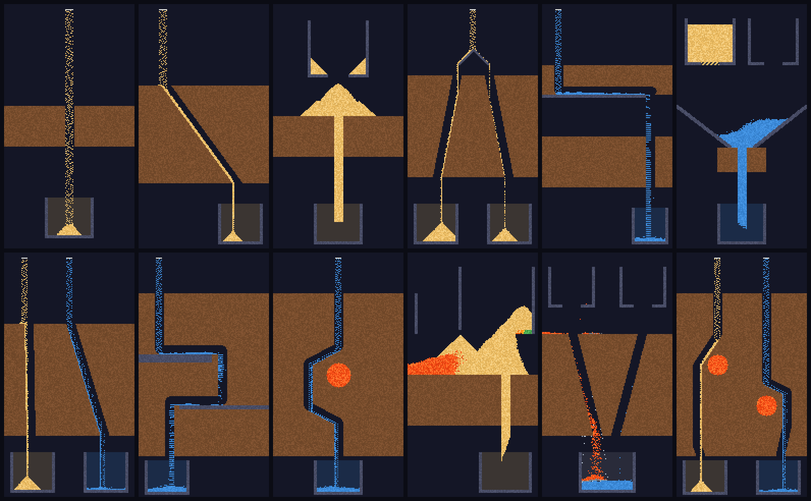

# Grainfall

A pixel-physics puzzle game for iPhone. Every grain of sand, drop of water and blob of lava is
simulated. Dig through dirt and pull gates to pour the right material into each cup.



| Doc | |
|---|---|
| [`docs/01-ideation.md`](docs/01-ideation.md) | Top 5 concepts, weighted scoring, why Grainfall |
| [`docs/02-prd.md`](docs/02-prd.md) | Product requirements: audience, loop, content, App Store compliance |
| [`docs/03-spec.md`](docs/03-spec.md) | Technical spec: simulation rules, level format, rendering, audio, persistence, CI |
| [`docs/04-monetization.md`](docs/04-monetization.md) | Monetization plan: pricing, paywall, funnel model, growth, roadmap |
| [`docs/05-launch.md`](docs/05-launch.md) | App Store Connect, Game Center, QA and release checklist |

## Layout

```
Package.swift                 Swift package: GrainfallCore + grainfall-sim (builds on Linux and macOS)
Sources/GrainfallCore/        Engine-agnostic game logic: materials, simulation, levels, scoring, save data
  Resources/levels/           chapters.json + one JSON per level (with reference solution and traps)
Sources/grainfall-sim/        CLI: validate levels, trace, render PNG frames and level sheets
Tests/GrainfallCoreTests/     39 XCTest cases: materials, mechanics, determinism, cups, all 60 levels, saves
App/                          iOS app (XcodeGen): SwiftUI shell, Metal renderer, StoreKit 2, haptics
  project.yml                 → `xcodegen` generates Grainfall.xcodeproj
  Sources/Engine/             PixelSurface seam + Metal PixelRenderer, touch view, shaders
  Sources/Game/               GameController: fixed 60 Hz step, input → actions, HUD
  Sources/Views/              Title (live demo), level select, game HUD, results, paywall, settings
  Grainfall.storekit          Local StoreKit config for the Full Game IAP
AppStore/                     fastlane-style metadata + generated 6.9" screenshots
tools/                        set_pars.py, l10n.py (string catalog), screenshots/ (Playwright),
                              trailer.sh (1080×1920 social video), make_icon.py, levelgen/
```

## Build & test

Core and levels (Linux or macOS, Swift 5.9+):

```sh
swift test -c release -Xswiftc -enable-testing     # release: the debug simulation is ~50× slower
swift run -c release grainfall-sim validate        # every level: needs input, solvable at 3★, traps hold
swift run -c release grainfall-sim render 3-1 400 out.png --solve
swift run -c release grainfall-sim sheet docs/levels.png --scale 2
```

iOS app (macOS, Xcode 16+):

```sh
brew install xcodegen
cd App && xcodegen && open Grainfall.xcodeproj
```

Run the `Grainfall` scheme. It uses `Grainfall.storekit`, so the Full Game purchase works in the
Simulator without App Store Connect.

## Authoring a level

1. Add `Sources/GrainfallCore/Resources/levels/<id>.json` (format in spec §3) and list it in `chapters.json`.
2. Iterate with `grainfall-sim render <id> <tick> out.png [--solve]` and `trace <id> --solve`.
3. Add a `solution` (scripted digs/gate taps) and at least one `trap` for the obvious wrong idea.
4. Set `par` to [1.5×, 2.5×] of the solution's dig cost and `digBudget` to 3×. `validate` prints the cost.

## Engine integration

The studio Metal engine (bulkhead/matchday) wasn't available when this was built, so `App/Sources/Engine`
has a minimal Metal layer behind the `PixelSurface` seam: one texture upload and one draw per
frame. To move onto the studio engine, implement that seam with its sprite/texture path, call
`GameController.frame(now:)` from its frame callback, and forward its pointer events to
`GameController.touch`. `GrainfallCore` doesn't change.

## Before App Store submission

- [ ] Replace `com.yourstudio` (bundle ID, IAP product ID in `StoreService` and `Grainfall.storekit`) and set `DEVELOPMENT_TEAM`.
- [ ] Create the non-consumable `…fullgame` IAP in App Store Connect (Family Sharing on), with a review screenshot of the paywall.
- [ ] App Privacy: *Data Not Collected* (matches `PrivacyInfo.xcprivacy`). Age rating 4+.
- [ ] Final icon art, 6.9" and 6.5" screenshots (`grainfall-sim render` gives pixel-exact frames), App Preview video.
- [ ] Device pass: 60 fps on iPhone 11, haptics, purchase and restore in the sandbox, TestFlight beta.

## Status

**Content-complete v1.0 candidate.**
- **Gameplay:** 60 levels in 6 chapters, each CI-verified (needs input, solvable at 3★,
  traps hold). Ten materials plus drains and blast charges.
- **Presentation:**
  - Metal renderer with bloom.
  - Procedural sound and music.
  - Haptics, hints, the tutorial hand, the share card and the review prompt.
- **Platform:**
  - Game Center.
  - The Full Game purchase with its paywall flow.
  - Settings with sound, music, haptics, restore and reset.
  - Localization into 7 languages plus English.
  - Privacy manifest.
- **Store:** App Store metadata, screenshots and a social trailer.
- **CI:** builds the iOS app and smoke-tests it in the Simulator.

**Still needed before submission** (see docs/05-launch.md):
- studio bundle ID, team and IAP setup in App Store Connect
- Game Center IDs
- final icon art (the current one is generated)
- device QA on real hardware and a TestFlight beta
